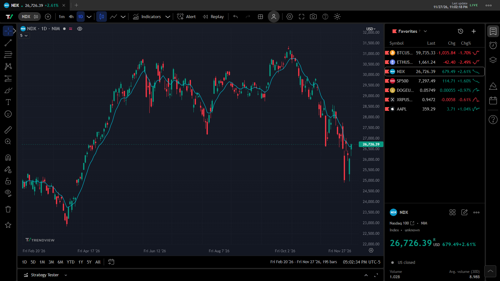
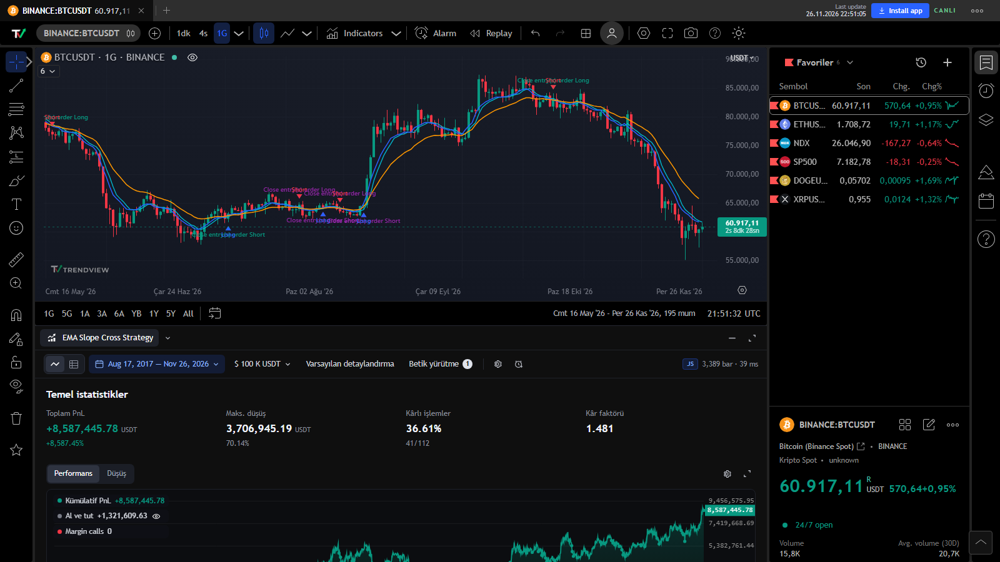
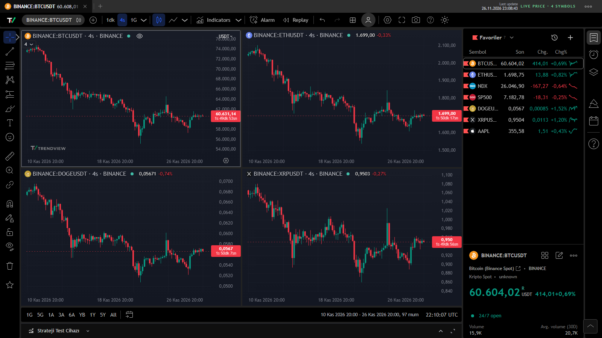

# TrendView

Free desktop and Android TradingView alternative powered by Rust. Multi chart layouts, live crypto, stock, and index data, custom Python strategies, and local deep backtesting.

 

## Screenshots

## Features

- Candlestick, Heikin Ashi, Renko, Kagi, Point and Figure, Line, Area, and Baseline charts with live streaming quotes.
- Full historical candle pagination for Binance, Bybit, MEXC, and Yahoo Finance cached locally in SQLite.
- Up to 16 synchronized chart panes in one window with custom grid layouts, drawing tools, price alerts, and watchlists.
- Technical indicators including EMA, SMA, WMA, VWMA, Bollinger Bands, Keltner Channels, Ichimoku, SuperTrend, Parabolic SAR, Donchian, VWAP, RSI, MACD, Stochastic, ATR, CCI, OBV, ADX, Williams %R, ROC, and Aroon.
- Strategy Tester and deep backtesting engine written in Rust with live progress, cancel support, intrabar detalization, take profit, stop loss, trailing stops, commission, slippage, leverage, and CSV trade export.
- Local LAN transfer to sync watchlists, drawings, layouts, alerts, and custom scripts between desktop and Android.

## Custom indicators and strategies

Write your own Python indicators or trading strategies with long, short, and close orders. See [STRATEGIES.md](STRATEGIES.md) for the SDK guide and examples.

## License

TrendView is free for personal use and unmodified sharing. Modifying the software, creating derivative works, or using it commercially is not allowed. See [LICENSE](LICENSE) for full terms.
